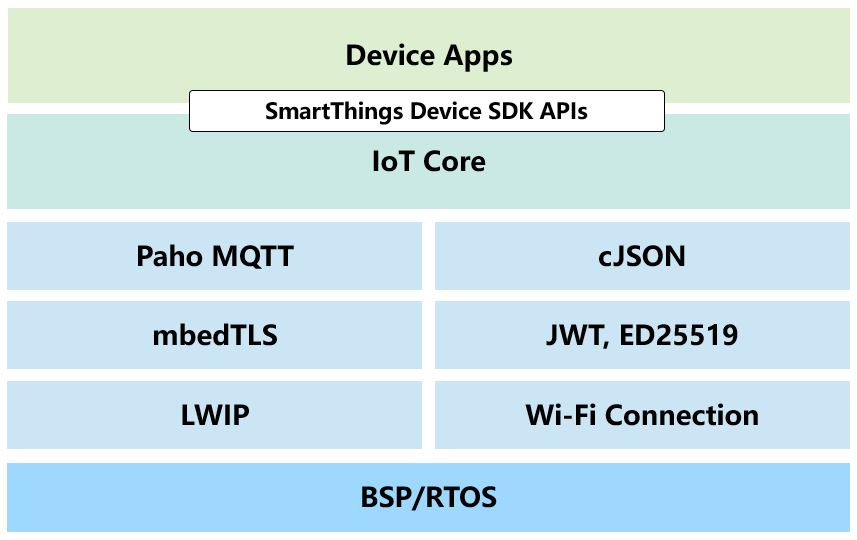

# SmartThings Device SDK Porting Guide

This document explains how you can port the SmartThings Device SDK(STDK for short) for C to a new chipset platform.

## Specification

- **WiFi**
  - It depends on whether the chipset is supported, but the SDK supports the specifications listed below.
  - Supported Frequency band
    - 2.4G
    - 5G
  - Supported Authentication
    - OPEN
    - WEP
    - WPA
    - WPA2
    - WPA/WPA2
    - WPA2_Enterprise
    - WPA3
      
- **Bluetooth**
  - Bluetooth 5.0 or higher
  - BLE(Bluetooth Low Energy)
    - BLE Advertising Period
      - Out of Box (Pre-Onboarding) : 20ms
      - Onboarded : 100ms
  - Gatt(Generic Attribute Profile)

- **Security**
  - SecureBoot
  - Hardware Security Module
    - Encrypted Non Volatile Memory Region
    - TrustZone
    - External HW Security module (eSE)
  - mbedTLS
    - Version 3.6.X (Recommended)
      
- **OS**
  - RTOS
  - Linux
  - Posix
  
## Build system

By default, the STDK uses the build system of the chipset vendor, so you must install the toolchain provided by the vendor of the chipset that you want to develop.

- **Example for ESP32**

  ESP32 supports multiple host environments including Windows, Linux, and macOS. Based on experience, compile times are significantly faster on Linux but it is up to you which environment you prefer to use. Anyway, in this document, we will describe this on Linux. If you want to use other environments, please refer to the [chipset vendor's guides](https://docs.espressif.com/projects/esp-idf/en/latest/esp32/get-started/index.html).

  1. Get STDK source code

     There are two git repositories for working with the SmartThings SDK. One git repository has the core Internet of Things (IoT) library while the second git repository has example device applications.

     - [IoT Core Device Library](https://github.com/SmartThingsCommunity/st-device-sdk-c)
     - [Reference](https://github.com/SmartThingsCommunity/st-device-sdk-c-ref)

     From the terminal, navigate to the directory you want the STDK to live and clone it using the following git command:

     ```sh
     cd ~
     git clone https://github.com/SmartThingsCommunity/st-device-sdk-c.git
     git clone https://github.com/SmartThingsCommunity/st-device-sdk-c-ref.git
     ```

  2. Get chipset SDK

     Download an original chipset SDK you want to port

     ```sh
     mkdir -p ~/esp
     cd ~/esp
     git clone --recursive https://github.com/espressif/esp-idf.git
     ```

  3. Setup build environment

     Now you have to choose whether to configure the build environment as a chipset SDK-based or STDK-based.
  
     If you want to configure a build environment based on chipset SDK, you can place the IoT core device library into `~/esp/esp-idf/components/` . From now on, it's more helpful to see the chipset vendor's guides for more details.

     Here, I will explain setting up a build environment based on the STDK [reference git repository](https://github.com/SmartThingsCommunity/st-device-sdk-c-ref).

     Place the IoT core device library and the chipset SDK into reference git repository.

     ```sh
     #Place the IoT core device library into reference(examples) git repository.
     cd ~
     cp -r ./st-iot-device-sdk-c/* ./st-device-sdk-c-ref/iot-core/
      
     #Place the chipset SDK into reference(examples) git repository.
     cd ~/st-device-sdk-c-ref/bsp
     mkdir esp32
     cp -r ~/esp/esp-idf/* ./esp32/
     ```

     After porting, you can register this job as git submodules and do it easily.

  4. Set up the tools

     Aside from the ESP-IDF, you also need to install the tools used by ESP-IDF, such as the compiler, debugger, Python packages, etc.

     ```sh
     cd ~/esp32
     ./install.sh esp32
     ```

  5. Make a build script.

     Please refer to the pre-supplied scripts(such as `build.sh`, `build_esp32.sh`) that ported on the ESP32 board using freeRTOS for easier understanding.

     ```sh
     cd ~/st-device-sdk-c-ref
     tree
     .
     |-- ......
     |-- build.sh
     |-- ......
     |-- setup.sh
     `-- tools
         |-- ......
         |-- esp32
         |   |-- build_esp32.sh
         |   |-- ......
         |   `-- setup_esp32.sh
         |-- ......
     ```


## Directory layout

Like other SDKs, the STDK have platform-dependent and platform-independent directories. The platform-dependent directories that must be ported have been marked in Bold as shown below.

- apps : sample device applications for each chipset
- bsp : original chipset vendor's SDKs will be copied here
- doc : documents
- **iot-core** : IoT core device library will be copied here
  - src
    - include : there are declarations of functions to be ported
    - **port** : add a new directory that you want to port
      - **bsp**
        - **esp32**
        - **posix**
        - **{new chipset}**
      - **net**
        - **mbedtls**
        - **openssl**
        - **{new library}**
      - **os**
        - **freertos**
        - **posix**
        - **{new OS}**
    - ......
  - ......
- output : build outputs will be placed
- patches : patches to be applied in the original chipset vendor's SDK for resolving some problems
- tools : scripts to be applied for each chipset

If you port a new chipset or OS, please submit or inform your porting results to merge [IoT core device library git repo](https://github.com/SmartThingsCommunity/st-device-sdk-c).

## Porting

The IoT core device library has a porting layer to support the use of the same APIs in the device application, even if the platform changes. In the current STDK version, the platform-dependent directories that must be ported are present in the `src/port/bsp`, `src/port/net` and `src/port/os` of [IoT core device library git repo](https://github.com/SmartThingsCommunity/st-device-sdk-c).



### Currently Ported Chipsets

The following chipsets already have a porting layer implemented under `src/port/bsp/`:

- **bk7236** - Beken WiFi SoC
- **bl602** - Bouffalo Labs WiFi/BLE SoC (sources only; not wired into `src/Kconfig` or `src/component.cmake`)
- **esp32** - Espressif ESP32, ESP32-S2, ESP32-C3 (WiFi/BLE)
- **raspberry** - Raspberry Pi (Linux)
- **posix** - Generic POSIX host, used when no other BSP is selected

Use these as reference implementations when porting to a new chipset.

### Directory Structure for a New Port

When porting to a new chipset named `{chipset}`, create the following structure under `src/port/bsp/`:

```
src/port/bsp/{chipset}/
├── CMakeLists.txt
├── iot_bsp_system_{chipset}.c
├── iot_bsp_wifi_{chipset}.c
├── iot_bsp_ble_{chipset}.c
├── iot_bsp_fs_{chipset}.c
├── iot_bsp_nv_data_{chipset}.c
├── iot_bsp_random_{chipset}.c
└── iot_bsp_debug_{chipset}.c
```

Each `.c` file implements the STDK BSP API functions for that subsystem. All 8 files are required; see the "BSP(Board Support Package)" section below for the complete API specification.

### AI-Assisted Porting

The `skills/stdk-chipset-porting` skill can write a porting layer for an unsupported chipset. It requires a link to the target chipset's SDK/firmware source or API documentation, since accurate porting code depends on knowing the chipset's actual APIs. The skill checks that the SDK matches the chipset, runs a static verifier, compiles each file with the SDK's toolchain where one is available, and reports what it could not check. The result has not been run on hardware, so review the listed assumptions and test it on a device before shipping. See the skill's `SKILL.md` for usage details.

### Support Tools

If you meet some porting trouble, try using the following tools.
- [STDK Dev Support](./tools/STDK_dev_support/README.md) : It is designed to perform the onboarding process identically to the standard app and provide various information to the app side, so it is expected to be of great help in analyzing issues during porting.
- [STDK Emulator](./tools/STDK_emulator/README.md) : You can obtain a reference device simply by installing the app. This is expected to help in the comparative analysis of issues that arise during porting.

### BSP(Board Support Package)

The BSP is the well-defined set of functions that the IoT core device library invokes in order to interact with a platform's specific networking, file IO, random number generator, and system feature.

In other words, porting APIs which are ported are designed to be implemented only for the functions required by the IoT core device library. The APIs to be ported by each hardware architecture are listed below by category, plus two optional ones (`iot_bsp_fs_open_from_stnv` and `iot_bsp_system_set_timezone`). The declarations in `src/include/bsp/*.h` are authoritative for your SDK version; if this page disagrees with them, follow the headers.

For additional information about API parameters, please refer to the [API document](https://github.com/SmartThingsCommunity/st-device-sdk-c/blob/master/doc/APIs.md).

#### File system

| APIs                                                         | Description                                                  |
| ------------------------------------------------------------ | ------------------------------------------------------------ |
| iot_error_t iot_bsp_fs_close( iot_bsp_fs_handle_t  handle )  | Close a file.                                                |
| iot_error_t iot_bsp_fs_deinit  (  )                          | Deinitialize a file system.                                  |
| iot_error_t iot_bsp_fs_init  (  )                            | Initialize a file system. <br/>This function initialize the file-system of the device. You must call this function before using file-management function (open, read, write, etc.) |
| iot_error_t iot_bsp_fs_open  ( const char *  filename, iot_bsp_fs_open_mode_t  mode,    iot_bsp_fs_handle_t *  handle ) | Open a file.                                                 |
| iot_error_t iot_bsp_fs_read  ( iot_bsp_fs_handle_t  handle, char *  buffer,   size_t * length ) | Read a file.                                                 |
| iot_error_t iot_bsp_fs_remove  ( const char *  filename )    | Remove a file.                                               |
| iot_error_t iot_bsp_fs_write  ( iot_bsp_fs_handle_t  handle, const char *  data, size_t  length ) | Write a file.                                                |
| iot_error_t iot_bsp_fs_open_from_stnv  ( const char *  filename, iot_bsp_fs_handle_t *  handle ) | **Optional.** Open a file from the stnv (manufacturer data) partition as a read-only handle. Needed only when the platform keeps such a partition (the ESP32 port builds it under `CONFIG_STDK_IOT_CORE_SUPPORT_STNV_PARTITION`). |

#### Non-volatile storage

| APIs                                                         | Description                                                  |
| ------------------------------------------------------------ | ------------------------------------------------------------ |
| const char* iot_bsp_nv_get_data_path  ( iot_nvd_t  nv_type ) | Get a nv data path. <br/>This function will return the nv data path. The detail of data path is depend on the file-system type.<br/>ex)<br/> : espressif nvs-system - nvs key ("nvItemKey") <br/> : Linux file-system - file path ("/stnv/nvItemKey") |

#### Random number

| APIs                              | Description                                                  |
| --------------------------------- | ------------------------------------------------------------ |
| unsigned int iot_bsp_random  (  ) | Generate random number. <br/>This function generate and return random number. |

#### System

| APIs                                                         | Description                |
| ------------------------------------------------------------ | -------------------------- |
| iot_error_t iot_bsp_system_get_time_in_sec  ( time_t *  time_in_sec ) | Get system time in second. |
| void iot_bsp_system_poweroff  (  )                           | Shutdown system.           |
| void iot_bsp_system_reboot  (  )                             | Restart system.            |
| iot_error_t iot_bsp_system_set_time_in_sec  ( time_t  time_in_sec ) | Set system time in second. |
| const char *iot_bsp_get_bsp_name  (  )                       | Get bsp name.              |
| const char *iot_bsp_get_bsp_version_string  (  )             | Get bsp version string.    |
| iot_error_t iot_bsp_system_set_timezone  ( char *  timezoneid ) | **Optional.** Set the system timezone from an IANA timezone id such as `Asia/Seoul`. |

#### Wi-Fi

| APIs                                                         | Description                                                  |
| ------------------------------------------------------------ | ------------------------------------------------------------ |
| iot_error_t iot_bsp_wifi_init  (  )                          | Initialize Wi-Fi function.                                   |
| iot_error_t iot_bsp_wifi_set_mode  ( iot_wifi_conf *  conf ) | Set the Wi-Fi mode                                           |
| uint16_t iot_bsp_wifi_get_scan_result  ( iot_wifi_scan_result_t *  scan_result ) | Get the AP scan result.                  |
| iot_error_t iot_bsp_wifi_get_mac  ( struct iot_mac *  wifi_mac ) | Get the Wi-Fi MAC.                                       |
| iot_wifi_freq_t iot_bsp_wifi_get_freq  ( void   )            | Get the Wi-Fi Frequency band.                                |
| iot_error_t iot_bsp_wifi_register_event_cb(iot_bsp_wifi_event_cb_t cb) | Register Wi-Fi event callback                      |
| void iot_bsp_wifi_clear_event_cb(void)                       | Clear Wi-Fi event callback                                   |
| iot_wifi_auth_mode_bits_t iot_bsp_wifi_get_auth_mode(void)   | Get Wi-Fi module's supported Authentication/Encryption modes |
| void iot_bsp_wifi_get_status( iot_wifi_info *  wifi_info )   | Get the current Wi-Fi station status.<br/>Fill every field of `wifi_info` (connection state, last disconnect reason, AP SSID/BSSID/RSSI, IP status/address), using the `*_UNKNOWN` values when a status is unavailable. The SDK polls this every few seconds while connecting to the server, so it must return quickly and not block (e.g. no scanning). `iot_bsp_wifi_is_dhcp_success()` is no longer declared in the BSP header; IP assignment is reported here instead. |

#### BLE

| APIs                                                         | Description                                                  |
| ------------------------------------------------------------ | ------------------------------------------------------------ |
| iot_error_t iot_bsp_ble_init( iot_ble_cbs_t *  ble_cbs)      | Initialize BLE function.                                     |
| void iot_bsp_ble_deinit(void)                                | Deinitialize BLE function.                                   |
| int iot_send_indication( uint8_t *  buf, uint32_t  len )     | Send indication.                                             |
| uint32_t iot_bsp_ble_get_mtu(  )                             | Get MTU size.                                                |
| int iot_bsp_ble_start_adv( uint16_t  mn_code, uint8_t *  mn_data, size_t  mn_data_len, char *  local_name )      | Start BLE advertisement. |
| int iot_bsp_ble_get_mac_address( uint8_t  mac_address[6] )   | Get BLE MAC address.                                         |

#### Debug

| APIs                                                         | Description                                                  |
| ------------------------------------------------------------ | ------------------------------------------------------------ |
| void iot_bsp_debug  ( iot_debug_level_t  level,  <br/>  const char *  tag,  <br/>  const char *  fmt,  <br/>    ...  <br/> ) | Write message into the log. <br/>This function is not intended to be used directly. Instead, use one of IOT_ERROR, IOT_WARN, IOT_INFO, IOT_DEBUG macros. |
| void iot_bsp_debug_check_heap  ( const char *  tag,  <br/>  const char *  func,  <br/>  const int  line,  <br/>  const char *  fmt,  <br/>    ...  <br/> ) | Check memory(heap) status.                                   |

#### Behavioral requirements

Matching the signatures is necessary but not sufficient: the core relies on the behaviors below. They are taken from the esp32 and bk7236 ports and from the core code that calls the BSP, so every port must reproduce them with the vendor SDK's own APIs.

**Wi-Fi**

- `iot_bsp_wifi_init()` brings up the Wi-Fi stack and registers vendor event handlers. The handlers must (a) record the station state that `iot_bsp_wifi_get_status()` reports and (b) wake any thread waiting in `iot_bsp_wifi_set_mode()`.
- `iot_bsp_wifi_set_mode()`:
  - `IOT_WIFI_MODE_STATION`: disconnect from any previous AP, apply `ssid`/`pass`/`authmode` (and `bssid` when set), start the connection, then **wait up to `IOT_WIFI_CMD_TIMEOUT` ms for either "connected" or "failed"**. Return `IOT_ERROR_NONE` only when connected. Return a negative `iot_error_t` from `iot_error.h` (for example `IOT_ERROR_CONN_STA_CONN_FAIL`) on failure or timeout. Both outcomes must be signalled from the vendor event handler; waiting on a failure signal that is never raised just burns the whole timeout.
  - `IOT_WIFI_MODE_SCAN`: put the radio in station-capable mode without connecting. The scan itself runs in `iot_bsp_wifi_get_scan_result()`.
  - `IOT_WIFI_MODE_SOFTAP`: start an AP with the given `ssid`/`pass`/`authmode` on channel `IOT_SOFT_AP_CHANNEL`.
  - `IOT_WIFI_MODE_OFF`: stop Wi-Fi.
- `iot_bsp_wifi_get_scan_result()` fills up to `IOT_WIFI_MAX_SCAN_RESULT` entries (`ssid`, `bssid[]`, `rssi`, `freq`, `authmode`) and returns how many it filled.
- The event callback registered with `iot_bsp_wifi_register_event_cb()` is for **soft-AP events only**: `IOT_WIFI_EVENT_SOFTAP_STA_JOIN` when a phone joins the AP, `..._STA_LEAVE` when it leaves, `..._STA_FAIL` on an AP-side failure. Do **not** emit them for station connect/disconnect; the core learns about station state by polling `iot_bsp_wifi_get_status()`.
- After station association, start DHCP and report the address through `iot_bsp_wifi_get_status()` (`IOT_IP_STATUS_NOT_ASSIGNED` until one arrives). Do not make `iot_bsp_wifi_set_mode()` wait for it unless the vendor stack does so itself.
- `iot_bsp_wifi_get_status()` must report a real RSSI and the last disconnect reason (mapped to `iot_wifi_disconnected_reason`), not constants.

**BLE**

- `iot_bsp_ble_init()` registers the vendor stack's GAP and GATT callbacks, creates the onboarding GATT service, and stores `ble_cbs`. It does **not** start advertising; the core calls `iot_bsp_ble_start_adv()` when it wants that.
- GATT service: 16-bit service UUID `0xFD1D` with a single characteristic whose 128-bit UUID is `BE940F0E-AE2D-4F8E-A4C7-300280E60E09` (little-endian bytes `09 0E E6 80 02 30 C7 A4 8E 4F 2D AE 0E 0F 94 BE`). The characteristic supports **write** and **indicate**, has a Client Characteristic Configuration descriptor, and holds up to 1024 bytes.
- A write to the characteristic must call `ble_cbs->write_cb(data, len)`. A connect or disconnect must call `ble_cbs->conn_cb(IOT_BLE_CONNECTION_EVENT_CONNECTED / _DISCONNECTED)`. These calls are made from the vendor callback you registered, and a callback that is never registered never runs.
- The core calls `iot_bsp_ble_init()` at the start of each onboarding session and `iot_bsp_ble_deinit()` at the end, so init must work again after deinit. If the vendor stack cannot be shut down cleanly, leave it running and only re-register the callbacks and service state.
- `iot_send_indication()` sends an indication on that characteristic. Return 0 on success and non-zero on failure. The core sends a fragmented response by calling it in a loop, and only one indication can be outstanding until the peer confirms it. Before sending, wait for the previous indication's confirmation (esp32 and bk7236 time out after 5 s and return non-zero, and also return non-zero if the connection is gone).
- `iot_bsp_ble_get_mtu()` returns the negotiated ATT MTU (23 until the peer negotiates a larger one). The core splits payloads by it.
- `iot_bsp_ble_start_adv()` builds a connectable advertisement:
  - Advertising data: flags `02 01 04`, then manufacturer-specific data `len FF <mn_code little-endian> <mn_data>`.
  - Everything must fit 31 bytes. If `mn_data` doesn't, put the overflow in the scan response.
  - Scan response: complete local name (`len 09 <name>`), then any manufacturer-data overflow.
  - Each `len` byte counts the type byte plus the payload, not itself.
  - Advertising interval is 20 to 40 ms (0x20 to 0x40 in 0.625 ms units), as in the esp32 port.
  - The caller frees `mn_data` as soon as the function returns, so copy `mn_data` and `local_name` if the stack needs them later.
  - Return 0 on success and 1 on failure; the core treats any non-zero value as a failure.
- `iot_bsp_ble_get_mac_address()` returns the 6-byte BLE address.

**Non-volatile storage and file system**

- `iot_bsp_nv_get_data_path()` and `iot_bsp_fs_*` use one naming scheme. Each `iot_nvd_t` value is its own file/key.
- **Two different names must never share storage.** Do not hash names into a small pool of sectors. Use the vendor's key-value or file system (NVS, LittleFS, FAT, flash KV, and so on), or a layout with one slot per `iot_nvd_t` value.
- Flash partition addresses and sizes come from the vendor's flash layout or partition table, never made up. Document the choice and make it configurable.
- `iot_bsp_fs_read()` of a missing file returns `IOT_ERROR_FS_NO_FILE`. `iot_bsp_fs_write()` replaces the whole file, and `iot_bsp_fs_remove()` deletes it. Check and return the vendor driver's errors.
- `iot_bsp_fs_open_from_stnv()`, if implemented, reads from the separate manufacturer partition and never from the writable NV area.

**Time, random, system**

- `iot_bsp_system_get_time_in_sec()` returns seconds since the Unix epoch from the platform clock/RTC. If the chip has no RTC, keep an offset from the tick counter that `iot_bsp_system_set_time_in_sec()` sets.
- The core also calls libc `gettimeofday()` directly. Check that it works on your target and has sub-second resolution; if the libc lacks it or the clock only counts whole seconds, provide it in the port (for example from the tick counter).
- `iot_bsp_random()` should come from the hardware TRNG when the chip has one. If the SDK only offers a software generator, use it, make sure it does not repeat the same sequence on every boot, and note the limitation in the port and in the summary.
- `iot_bsp_get_bsp_version_string()` should return something meaningful, such as the vendor SDK version.

#### Registering a new BSP in the build

Implementing the APIs above is not enough: the build must be able to select and compile the new port. For a chipset named `<chipset>`:

1. **`src/port/bsp/<chipset>/CMakeLists.txt`** — add the always-built sources to `target_sources(iotcore ...)`, put the BLE source inside `if(CONFIG_STDK_IOT_CORE_EASYSETUP_BLE)` together with the vendor's Bluetooth library, and link the vendor components you call. See `esp32/` and `bk7236/`. If the vendor build is not CMake-based, still provide this file and add the vendor-native integration (for example a Makefile fragment) next to it, with usage notes in a README in the same directory.
2. **`src/Kconfig`** — add `config STDK_IOT_CORE_BSP_SUPPORT_<CHIPSET>` to the `STDK_IOT_CORE_BSP_SUPPORT` choice.
3. **`src/component.cmake`** — add an `elseif(CONFIG_STDK_IOT_CORE_BSP_SUPPORT_<CHIPSET>)` branch that appends `port/bsp/<chipset>` to `STDK_SRC_PATH` and `include/bsp/<chipset>` to `STDK_INCLUDE_PATH`, plus any extra include paths or flags the vendor SDK needs.
4. **`src/include/bsp/<chipset>/iot_bsp_custom.h`** — a header that pulls in the vendor's configuration (the ESP32 one includes `sdkconfig.h`).

### OS

These APIs are related to operating system.

#### Utils

| APIs                                                         | Description                                                  |
| ------------------------------------------------------------ | ------------------------------------------------------------ |
| void iot_os_delay  ( unsigned int  delay_ms )                | This function will delay thread for given time               |
| unsigned int iot_os_eventgroup_clear_bits  ( iot_os_eventgroup *  eventgroup_handle,  <br/>  const unsigned char  bits_to_clear ) | This function will clear bit/bits of eventgroup              |
| iot_os_eventgroup* iot_os_eventgroup_create  ( void   )      | This function create eventgroup and return eventgroup handle |
| void iot_os_eventgroup_delete  ( iot_os_eventgroup *  eventgroup_handle ) | This function delete eventgroup                              |
| unsigned int iot_os_eventgroup_set_bits  ( iot_os_eventgroup *  eventgroup_handle,  <br/>  const unsigned char  bits_to_set ) | This function will set bit/bits of eventgroup                |
| unsigned char iot_os_eventgroup_wait_bits  ( iot_os_eventgroup *  eventgroup_handle,  <br/>  const unsigned char  bits_to_wait_for,  <br/>  const int  clear_on_exit,  <br/>  const unsigned int  wait_time_ms ) | This function will wait for bit of group of bits to become set |
| int iot_os_mutex_init  ( iot_os_mutex *  mutex )             | This function will create mutex                              |
| int iot_os_mutex_lock  ( iot_os_mutex *  mutex )             | This function will lock mutex before critical section        |
| int iot_os_mutex_unlock  ( iot_os_mutex *  mutex )           | This function will unlock mutex after critical section       |
| iot_os_mutex_destroy(iot_os_mutex* mutex)                    | This function will destroy mutex       |
| int iot_os_thread_create  ( void *  thread_function,  <br/>  const char *  name,  <br/>  int  stack_size,  <br/>  void *  data,  <br/>  int  priority,  <br/>  iot_os_thread *  thread_handle ) | This function create and run thread                          |
| void iot_os_thread_delete  ( iot_os_thread  thread_handle )  | This function delete thread                                  |
| void iot_os_thread_yield  (  )                               | This function yields task                                    |
| int iot_os_thread_get_current_handle(iot_os_thread* thread_handle)      | This function will get current thread handle     |
| void iot_os_timer_count_ms  ( iot_os_timer  timer,  <br/>  unsigned int  timeout_ms ) | This function will set timer count in ms unit.               |
| void iot_os_timer_destroy  ( iot_os_timer *  timer )         | This function will destroy timer struct                      |
| void iot_os_timer_init  ( iot_os_timer *  timer )            | This function will init timer struct                         |
| char iot_os_timer_isexpired  ( iot_os_timer  timer )         | This function will check if timer is expired                 |
| int iot_os_timer_start(iot_os_timer_handle timer_handle)     | This function will start timer                               |
| int iot_os_timer_stop(iot_os_timer_handle timer_handle)      | This function will stop timer                                |
| bool iot_os_timer_is_active(iot_os_timer_handle timer_handle)  | This function will check timer active                      |
| iot_os_timer_handle iot_os_timer_create(iot_os_timer_cb cb, unsigned int expiry_time_ms, void *user_data)  | This function will create timer         |
| void iot_os_timer_delete(iot_os_timer_handle timer_handle)  | This function will delete timer                      |
| unsigned int iot_os_timer_left_ms  ( iot_os_timer  timer )   | This function will return remaining time in ms unit          |
| const char *iot_os_get_os_name  ( )                          | This function will return name of os                         |
| const char *iot_os_get_os_version_string  ( )                | This function will return version string of os               |

